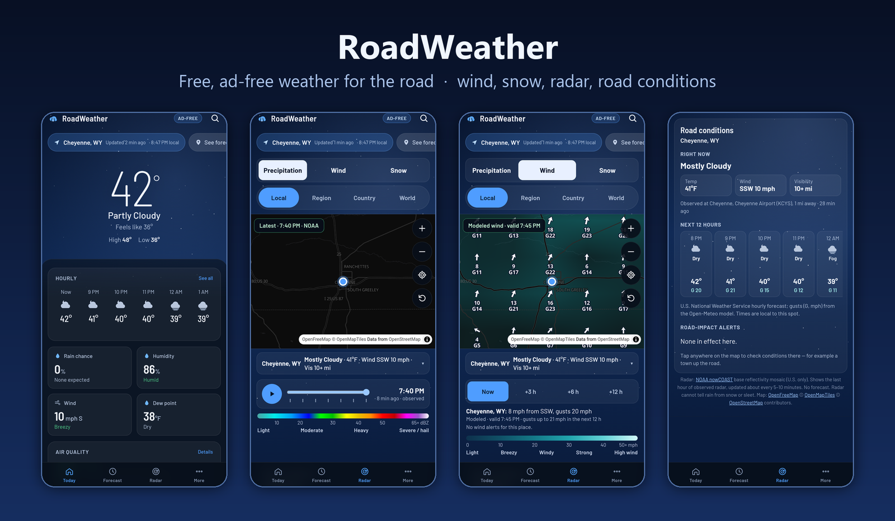
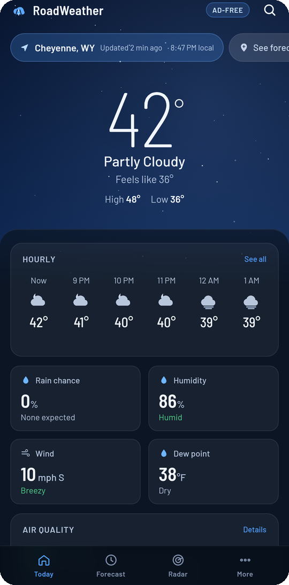
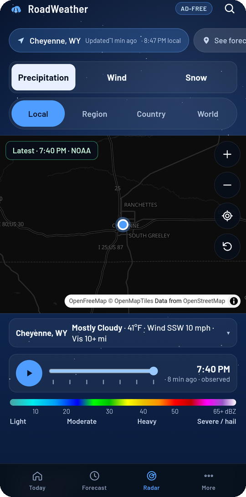
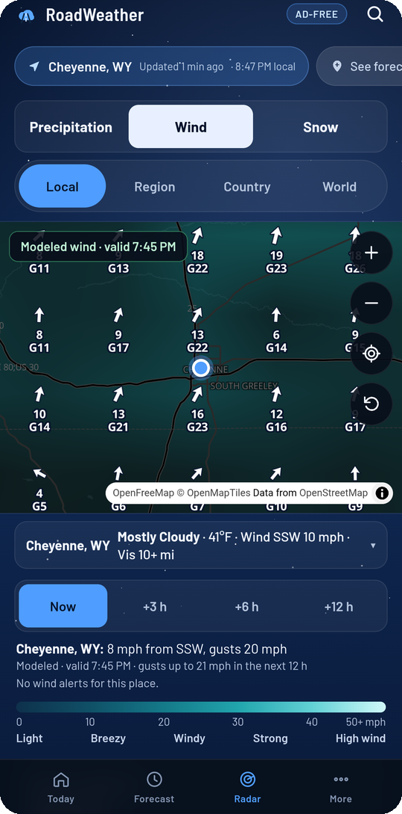
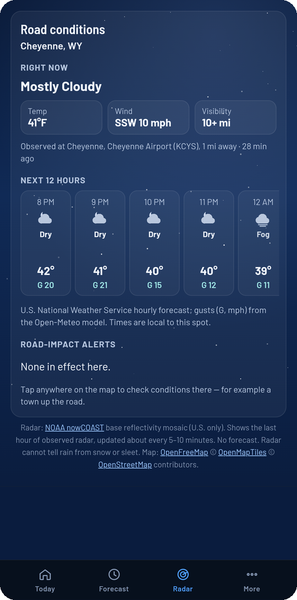
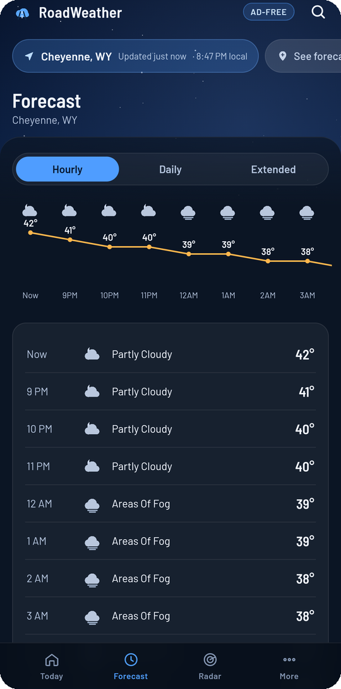

# RoadWeather

**Free, ad-free weather for the road — made for my dad, a truck driver.**

[**⬇ Download the latest version**](https://github.com/trashburrito/roadweather-releases/releases/latest) · Android 8 or newer · English & Español

## Why I made this

My dad drives a truck for a living. Out on the highway, the weather that matters isn't "sunny, 72°" — it's how hard the
wind is gusting across an open stretch, whether snow is coming over the pass, and what the road ahead is doing right
now. I wanted him to have one app that puts **wind, snow and road conditions** first, shows the radar clearly, works in
**English and Spanish**, and has **no ads** — so I built RoadWeather for him.

It's free, and anyone can use it.

## What it does

<table>
<tr>
<td width="33%" valign="top"> <b>Today</b> Temperature, feels-like, high and low, the next hours, rain chance, wind and humidity at a glance.</td>
<td width="33%" valign="top"> <b>Radar</b> Live NOAA radar on a real map with a one-hour loop. Every frame shows its time and source.</td>
<td width="33%" valign="top"> <b>Wind</b> Wind arrows and gusts on the map — now, +3, +6 and +12 hours — plus wind alerts for your spot.</td>
</tr>
<tr>
<td valign="top"> <b>Road conditions</b> What it's doing right now from the nearest weather station, the next 12 hours, and road-impact alerts. Tap anywhere on the map to check a town up the road.</td>
<td valign="top"> <b>Forecast</b> Hourly, daily and extended forecast with a temperature graph.</td>
<td valign="top"><b>Also</b>
<ul>
<li><b>Snow</b> on the map: snow on the ground, snowfall in the next 24–72 hours, winter alerts</li>
<li>Search any place and save the ones you use</li>
<li>Big buttons and large text, easy to read at a glance</li>
<li>Works offline with the last weather it loaded, and says so</li>
<li>No ads, no account, no tracking</li>
</ul></td>
</tr>
</table>

## Install

1. On your Android phone, open **[the latest release](https://github.com/trashburrito/roadweather-releases/releases/latest)** and tap **RoadWeather-1.2.apk** to download it.
2. Open the downloaded file. If Android asks, allow **Install unknown apps** for the browser or Files app you used.
3. Tap **Install**. Google Play Protect may say the developer is unknown: tap **More details → Install anyway**.
4. Open RoadWeather and allow location, so it shows the weather where you are.

**Updating:** install the newer APK the same way. It replaces the old one and keeps your saved places.
**Coming from version 1.1:** uninstall 1.1 first (write down your saved places, then add them again), because 1.1 was a
test build. From 1.2 on, updates install over the top.

## Honest weather

RoadWeather only shows real data from free public sources, and labels each one with its time and whether it's
**observed** or a **forecast**. When data is missing, old, or the phone is offline, the app says so instead of guessing.

Sources: U.S. National Weather Service · NOAA nowCOAST and NOHRSC · RainViewer · Open-Meteo · OpenFreeMap /
OpenStreetMap · Photon. Alerts and station observations cover the U.S.; elsewhere the app uses forecast models and says so.

## Check the download (optional)

| Version | File | SHA-256 |
|---|---|---|
| 1.2 | `RoadWeather-1.2.apk` | `f4cc96e3b6eb0afc9993ed5e3eb3d874872f3fcdf1aa5d1fe8aa3f1ff0131ae1` |

Signing certificate SHA-256: `99:98:77:51:44:F3:49:0D:C8:51:B9:E3:A9:42:B3:5E:FB:CF:A0:52:52:59:94:0F:A2:4C:A7:9C:8D:79:97:D6`

Screenshots taken on an Android emulator set to Cheyenne, WY.
